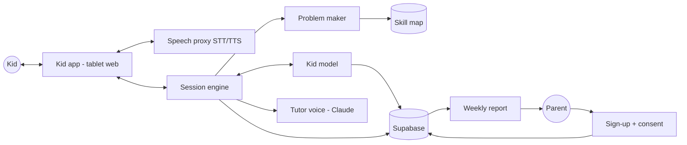

# Adaptive AI Tutor — v1 Design Spec

- **Date:** 2026-10-08
- **Status:** Approved (2026-10-09)
- **Companion:** Obsidian vault at `vault/` (same content, linked notes and graphs)

## 1. Intent

**Product:** an AI math tutor that adapts to each child in real time — private-school quality help for any family.

**What the user said**
- Real product, paid by families. Schools and investors later, as a learning platform — not built for in v1.
- Kids aged 5–7 and 8–11. Math only. English, US, Common Core.
- Adapts on two axes: **level** and **teaching style**. (Mood and interest themes: later.)
- Web app built for tablet browsers.
- Built by one person with Claude; real families in ~1–2 months.
- v1 success = **kids come back 3+ times a week** unprompted. Next: measurable learning gain, then paid conversion.
- Parent gets sign-up, COPPA consent, and a weekly report.

**Assumptions made (agreed during design)**
- Voice in and out is required (ages 5–7 can't read well).
- AI never grades math or decides what comes next; code does.

## 2. Scope of v1

One strand: **number sense → addition and subtraction**, about 25–35 small skills.

| Grade | Skill clusters |
|---|---|
| K | Count to 20; compare numbers; add within 10; subtract within 10 |
| 1 | Add and subtract within 20; place value (tens and ones) |
| 2 | Add and subtract within 100; word problems |

**Out of scope for v1:** multiply/divide, fractions, geometry, time, money; mood sensing; interest themes; parent dashboard and controls; payments; native app; other languages; school features.

## 3. Stack

| Part | Choice |
|---|---|
| App | Next.js + TypeScript (front and back) |
| Data + auth | Supabase (Postgres, row-level security) |
| Tutor voice | Claude API (`@anthropic-ai/sdk`) |
| Speech | Cloud STT + TTS vendor, called server-side; must not retain audio (vendor chosen during planning) |
| Email | Transactional email vendor (chosen during planning) |
| Consent | Stripe card verification |
| Hosting | Vercel |

## 4. Architecture



| Unit | Responsibility | Uses AI |
|---|---|---|
| Kid app | Problem screen, visuals (number line, ten-frame, blocks), tap/number-pad/voice input, audio playback | no |
| Speech proxy | Server-side STT/TTS calls; no audio stored | no |
| Session engine | Runs the problem loop; owns session state | no |
| Skill map | Static, versioned data in the repo | no |
| Problem maker | Seeded templates → problem + answer; answer checker | no |
| Kid model | Mastery per skill; level inside skill; next-skill choice; teaching-style choice | no |
| Tutor voice | Turns a structured turn plan into a short spoken line | **yes** |
| Parent side | Sign-up, consent, kid profiles, weekly report, distress emails, data rights | no (optional AI summary) |

**The loop (one problem)**
1. Engine asks kid model for the next skill (practice, step up, step back, or review).
2. Problem maker builds a problem and its answer.
3. Tutor voice presents it (given the answer and the chosen style by code).
4. Kid answers by tap or voice; **code checks it**.
5. Kid model updates.
6. If wrong: engine picks a teaching style → tutor voice explains → retry.

## 5. Skill map and problem maker

**Skill map** — TypeScript data in the repo (reviewable, versioned, testable):

```ts
type Style = "number-line" | "blocks" | "ten-frame" | "story" | "drawing";
type Skill = {
  id: string;            // "add-within-10.make-ten"
  name: string;          // "Make 10"
  grade: "K" | "1" | "2";
  commonCore: string[];  // ["K.OA.A.4"]
  needs: string[];       // prerequisite skill ids
  templates: string[];   // problem template ids
  styles: Style[];       // teaching styles that fit
};
```

Each cluster splits into 3–5 skills. Example — *Add within 10*: add with pictures (count all); add within 5; count on from the bigger number; make 10; missing number (3 + ? = 7).

Cluster prerequisites (draft; finalized when skills are written):
Count to 20 → {Compare numbers, Add within 10, Subtract within 10, Place value}; Compare numbers → Place value; {Add within 10, Subtract within 10} → Add/subtract within 20; {Add/subtract within 20, Place value} → Add/subtract within 100; {Add/subtract within 20, Add/subtract within 100} → Word problems.

**Problem template** — pure function `(seed, level) → Problem`:

```ts
type Problem = {
  prompt: { say: string; show: Visual };
  answer: number;
  input: "tap-choice" | "number-pad" | "voice" | "drag";
  choices?: number[];                              // includes answer; plausible wrong options
  mistakes: { answer: number; tag: string }[];     // e.g. 12 for 8+5 → "off-by-one-counting"
};
```

- Same seed → same problem.
- Level inside a skill = number size and fading picture support.
- Tagged mistakes tell the engine *why* a kid was wrong.
- Input by age: 5–7 get large tap choices and voice; 8–11 also get a number pad.

**Checker** — pure code; normalizes voice text ("twelve", "12") to a number; returns `correct | known-mistake(tag) | wrong`.

**Volume** — ~30 skills × 2–3 templates ≈ 60–90 templates, drafted with Claude from Common Core text and reviewed by the owner. Largest single work item in v1.

## 6. Kid model

All deterministic code.

**Mastery per skill** — Bayesian Knowledge Tracing: `pKnown` per kid × skill with per-skill parameters (prior, learn, slip, guess); defaults first, tuned later from data. **Mastered** = `pKnown ≥ 0.95` and ≥ 5 attempts.

**Level inside a skill** — 3 correct in a row → harder; 2 wrong in a row → easier.

**Next skill**
- **Struggling** (2 wrong in a row at the skill's easiest level, or the same mistake tag twice) → quick check on a prerequisite. (2 wrong in a row above the easiest level only lowers the level.) Fails → step back to it. Passes → stay and switch teaching style.
- **Mastered** → next skill whose prerequisites are all mastered.
- **Review** — ~1 in 5 problems is a mastered skill (oldest first); failing lowers `pKnown`.
- **Target ~80% correct** overall.
- **Loop guard** — max 3 step-backs in a row → easy review, end on a win, log.

**Placement** — first session: ~10 problems, binary search along the skill chain, starting from the parent-given grade.

**Teaching style** — per kid × style: tries and wins (win = explained in that style → next attempt correct). Choose by Thompson sampling over the skill's allowed styles; mistake tags bias the choice (e.g. `off-by-one-counting` → number line).

**Sessions** — 5–7: ~10–15 min; 8–11: ~15–20 min. Always end on a likely win.

**Tables**

| Table | Holds |
|---|---|
| `attempts` | kid, skill, template, seed, level, answer, result, mistake tag, style used, time taken, timestamp |
| `skill_state` | kid × skill: `pKnown`, level, streak, last seen |
| `style_stats` | kid × style: tries, wins |

## 7. Tutor voice (AI layer)

The AI phrases; it never decides.

**Input — turn plan**

```ts
type TurnPlan = {
  event: "present" | "correct" | "wrong" | "hint" | "explain" | "celebrate" | "kid-said";
  ageBand: "5-7" | "8-11";
  skill: string;
  problem: string;
  answer: number;
  kidAnswer?: number;
  mistakeTag?: string;
  style?: Style;
  kidSaid?: string;
  recentLines: string[];
};
```

**Output — structured JSON** via `output_config.format`:

```ts
type TutorLine = {
  say: string;             // ≤ 25 words (5–7), ≤ 40 words (8–11); may contain {name}
  show?: VisualCue;        // from a fixed list
  tone: "cheer" | "calm" | "curious";
};
```

**Model and latency**
- Claude Opus 5.5 (`claude-opus-5-5`), effort `low`. Sonnet 5.5 / Haiku 4.5 are options only if measured latency or cost requires — owner's decision.
- Streaming into TTS; target first audio ≈ 1.5 s.
- Prompt caching on the fixed system prompt (persona, rules, per-style guidance, examples); turn plan after the cache breakpoint.
- Server-side refusal fallback enabled (`fallbacks: "default"`); any refusal → canned line.

**Guards** (code, before any line is spoken)
1. Every number in `say` must appear in the problem, answer, or kid answer.
2. Answer may not be spoken before the kid has tried, except `correct` or a final `explain` after 2 failed tries.
3. Length and word-list limits by age band.
4. Failure → one retry → canned line for the event.
5. Timeout 2.5 s → canned line. Canned lines also cover outages and have pre-made audio.

**Privacy** — kid's name never sent (`{name}` placeholder filled by code). Only the turn plan is sent: no account data, no audio.

**Off-topic speech** — steer back to the problem; no open chat. Distress → see §8.

**Persona** — one friendly guide character, consistent voice. Name and look decided during planning.

## 8. Parent side and privacy (COPPA)

> Not legal advice. **A COPPA-experienced lawyer reviews this before the first family signs up.**

**Flow** — email-link sign-up → privacy notice → consent via Stripe card verification (no charge kept) → add kid (nickname, grade, avatar) → kid taps avatar to start. No kid login. Parent area behind a parent PIN.

**Consent before any kid data is collected.**

**Data kept per kid:** nickname, grade, avatar; `attempts`, `skill_state`, `style_stats`; distress-flag lines (30 days).
**Never kept:** last name, photo, school, birthday, location, audio, other free-speech text.

**Weekly report** (email, Sunday) — sessions, minutes, skills mastered, current skill, stuck points (from mistake tags), one tip for home. Built by code; optional AI summary without the name.

**Distress flag** — trigger list of words/phrases. Kid hears a fixed line ("That sounds hard. Please tell a grown-up you trust."). Parent emailed **immediately** with the line. App states it is not a crisis service.

**Parent rights** — view all kid data; delete a kid or the account (all data removed within 30 days); revoke consent (= delete).

**Retention** — while active; 12 months inactive → warning → delete.

**Vendors** — Supabase, Vercel, Anthropic, speech vendor, email vendor, Stripe; each under a data processing agreement with no training on our data.

**Never** — ads, data sales, third-party trackers or analytics SDKs in the kid area (first-party event counts only).

## 9. Errors

| Failure | Behavior |
|---|---|
| Network loss | Server persists after every answer; client retries; resume at same problem |
| AI slow/down | Canned line |
| STT down | Tap / number pad only; text always on screen |
| TTS down | Pre-made audio for canned lines; text always on screen |
| Low-confidence number from STT | "Did you say 12?" with yes/no tap |
| Template throws | Use another template for the same skill; log |
| Kid-model step-back loop | Loop guard (§6); log |
| Kid quits mid-problem | No penalty; attempt not counted |

**Monitoring** (server-side, no kid names): sessions per kid per week (north star); AI time-to-first-word; guard reject rate; canned-line rate; errors.

## 10. Testing

Test-first throughout.

| Kind | Coverage |
|---|---|
| Unit | Checker, BKT, next-skill picker, style picker (seeded randomness) |
| Property | Every template × 1,000 seeds: answer correct, numbers in range, choices unique and include answer |
| Simulated kids | Bot kids with known skill profiles and habits play 200 problems; assert placement accuracy, step-back, mastery reached, ~80% correct |
| AI evals | Turn-plan set across events × age bands × styles; guards checked by code; tone spot-read |
| Privacy | No name or audio leaves the server; RLS: family A cannot read family B |
| End-to-end | Tablet viewport: sign-up → consent (Stripe test mode) → session → report |
| Playtests | 3–5 real kids with a parent present before beta; observe without helping |

## 11. Open decisions (resolved during planning)

- Speech vendor (must offer no audio retention and handle children's speech well).
- Email vendor.
- Tutor character name and look.
- Exact distress trigger list (with legal review).
- BKT default parameters per skill.

## 12. Later (not v1)

More strands; mood sensing; interest themes; parent dashboard and controls; payments; native tablet app; school platform; learning-gain reports for investors.
