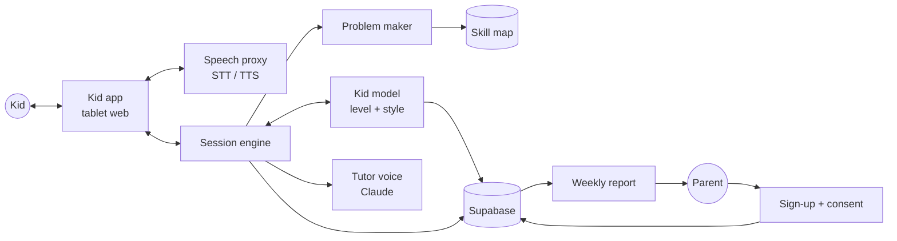

# Section 2: System parts

| Part | Job | AI? |
|---|---|---|
| Kid app | Session screen, number line / ten-frame / blocks, voice in/out | no |
| Speech proxy | Server-side calls to speech vendor; no audio stored | no |
| Session engine | Runs the loop: pick → show → check → update → hint | no |
| Skill map | Static, versioned data: skills, prerequisites, Common Core codes, templates | no |
| Problem maker | Fills templates with numbers; knows the answer; checks it | no |
| Kid model | Mastery score per skill; success rate per teaching style | no |
| Tutor voice | Turns a structured "what to say" into short, kid-friendly talk | **yes** |
| Parent side | Sign-up, COPPA consent, kid profiles, weekly report email | no (maybe AI summary) |

## The loop (one problem)
1. Engine asks the kid model → which skill next (practice, step up, or step back).
2. Problem maker builds a problem + the right answer.
3. Tutor voice says it (code gives it the answer and the chosen style).
4. Kid answers by tap or voice. **Code checks it.**
5. Kid model updates skill score.
6. Wrong → engine picks a teaching style → tutor voice explains → retry.

Related: [[Decision - Approach]], [[Decision - Stack]], [[Skill Map]]
