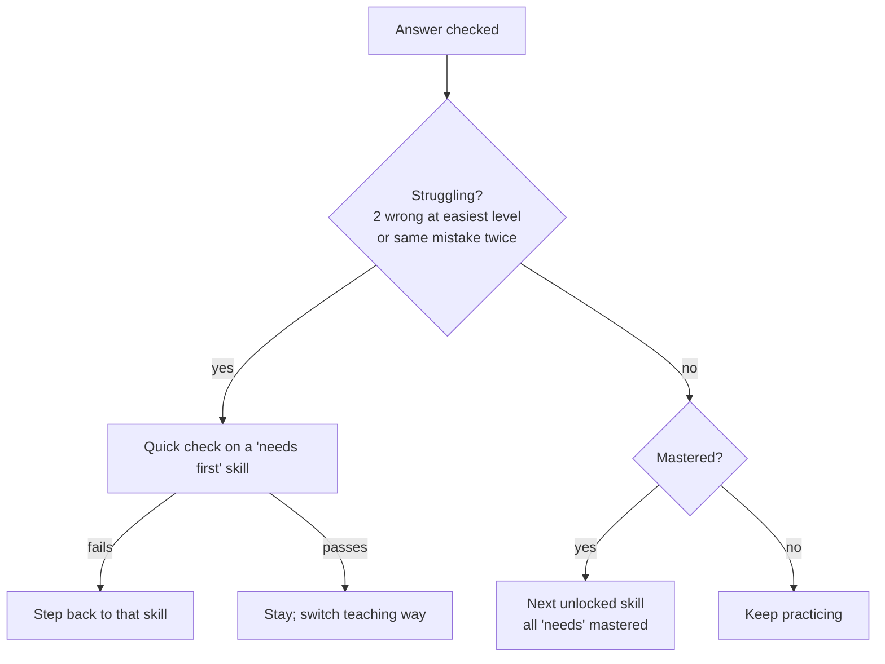

# Section 4: Kid model

All plain code. No AI. Two jobs: **level** and **teaching style**.

## Level

### Per-skill mastery — Bayesian Knowledge Tracing (BKT)
- Each skill has a chance the kid knows it: `pKnown`.
- 4 numbers per skill: start chance, learn rate, slip (knows but errs), guess (doesn't know but right). Sensible defaults first; tune later from real data.
- **Mastered** = `pKnown ≥ 0.95` and at least 5 tries.

### Inside a skill
- 3 right in a row → harder (bigger numbers, fewer pictures).
- 2 wrong in a row → easier. Already at easiest level → counts as "struggling" (below).

### Picking the next skill

- **Review:** about 1 in 5 problems is an old mastered skill (oldest first). Failing review lowers `pKnown`.
- **Target ~80% right** — hard enough to learn, easy enough to feel good (serves "kids come back").

### First session: placement
~10 problems that jump up and down the skill chain (binary search) so the kid starts at the right spot, not bored and not lost. Parent-given grade is the first guess.

## Teaching style
- Per kid, per style: count tries and wins. A **win** = explained this way → next try right.
- Pick style by **Thompson sampling** (a simple "try what works, sometimes test others" method) over styles allowed for the skill.
- **Mistake tags push the pick:** e.g. `off-by-one-counting` → number line first.
- Later: per kid + per skill group, once there is enough data.

## Sessions
- Ages 5–7: ~10–15 min. Ages 8–11: ~15–20 min.
- Always **end on a win** (finish with a problem the kid will likely get right).

## Data (Supabase)
| Table | Holds |
|---|---|
| `attempts` | every answer: kid, skill, template, seed, level, answer, result, mistake tag, style used, time taken |
| `skill_state` | kid × skill: `pKnown`, level, streak, last seen |
| `style_stats` | kid × style: tries, wins |

`attempts` is the source for the weekly report and, later, proof of learning.

Related: [[S3 - Skill Map and Problem Maker]], [[S2 - System Parts]], [[Success Metrics]]
