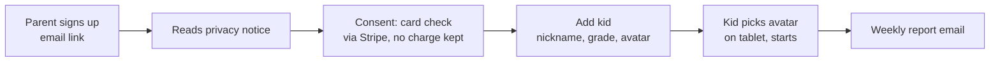

# Section 6: Parent side and privacy (COPPA)

> Not legal advice. **A lawyer who knows COPPA reviews this before the first family signs up.**

## Parent flow

- **Consent before any kid data is collected.** Method: card verification through Stripe (a recognized COPPA consent method, and it fits a paid product).
- **Kid has no login.** Kid taps their avatar on the parent's device. The parent area sits behind a "grown-up gate" (parent PIN).

## What we keep about a kid
| Keep | Never keep |
|---|---|
| Nickname, grade, avatar | Last name, photo, school, birthday, location |
| Answers, skill scores (`attempts`, `skill_state`, `style_stats`) | Audio (STT only turns speech into text, then audio is gone) |
| Distress-flag lines only (30 days) | Other free speech text |

## Weekly report (email, Sunday)
- Sessions, minutes, skills mastered, working on now, where stuck (from mistake tags), one tip for home.
- Built by code from the data. Optional AI-written summary — no name sent (see [[S5 - Tutor Voice]]).

## Distress flag
- Kid hears a fixed line: "That sounds hard. Please tell a grown-up you trust."
- Parent gets an **email right away** (not waiting for Sunday) with the kid's line.
- App says plainly it is not a crisis service.

## Parent rights (in the parent area)
- See all data about their kid.
- Delete a kid, or the whole account → all data gone within 30 days.
- Take back consent at any time (= delete).

## Retention
- Data kept while the account is active.
- No activity for 12 months → warning email → delete.

## Vendors (all must sign a data agreement, no training on our data)
Supabase · Vercel · Anthropic · speech vendor · email vendor · Stripe

## Never
- No ads. No selling data. No third-party trackers or analytics SDKs in the kid area (first-party event counts only).

Related: [[Users]], [[S5 - Tutor Voice]], [[S4 - Kid Model]]
