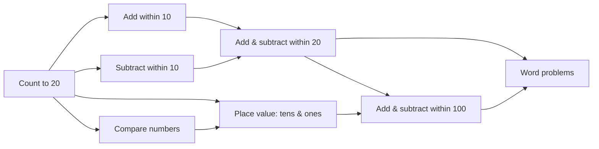

# Skill Map (draft)

Skill **clusters** for the v1 strand. Each cluster will split into 3–5 small skills in Section 3. Links = "needs first". Open Graph view to see the chain.

## Clusters
- [[Count to 20]] (K)
- [[Compare numbers]] (K)
- [[Add within 10]] (K)
- [[Subtract within 10]] (K)
- [[Add and subtract within 20]] (1)
- [[Place value - tens and ones]] (1)
- [[Add and subtract within 100]] (2)
- [[Word problems]] (2)

Related: [[S1 - Scope v1]], [[Decision - Approach]]
