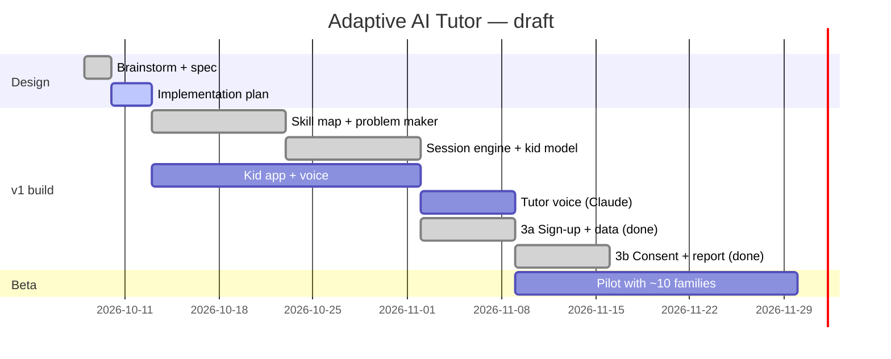

# Roadmap (draft)

Draft only — real phases come from the implementation plan after the spec is approved.

BKT defaults: prior 0.2, learn 0.15, slip 0.1; guess from input: 1 ÷ choices, number pad 0.15 (Plan 2).

## Later (not v1)
- More strands: multiply/divide, fractions, geometry, time, money
- Mood sensing, interest themes
- Parent dashboard + controls
- Payments
- Native tablet app
- Schools platform, investor data

Related: [[Success Metrics]], [[Design Overview]], [[S1 - Scope v1]]
