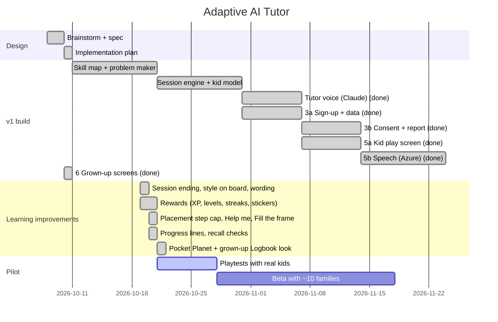

# Roadmap

Updated 2026-10-21. Details per feature: `docs/improvements/learning-experience-roadmap.md` and `docs/superpowers/specs/`.

BKT defaults: prior 0.2, learn 0.15, slip 0.1; guess from input: 1 ÷ choices, number pad 0.15 (Plan 2).

## Before the beta
- Renew brightling.ai (expires 2026-10-29); verify the Resend mail domain (GoDaddy DNS)
- Push migrations 0009–0010 to hosted Supabase; finish Supabase dashboard steps; Vercel deploy
- Speech on: Azure keys, pre-made audio, DPA + lawyer, real iPad check
- Claude voice on: live eval (~$1.10), retry-board number guard fix, lawyer question on kid speech

## Not built yet
- Placement by skill branch (only a step cap so far)
- Saying "help" to the mic; more interactive objects beyond Fill the frame

## Later (not v1)
- More strands: multiply/divide, fractions, geometry, time, money
- Mood sensing, interest themes
- Parent controls
- Payments
- Native tablet app
- Schools platform, investor data

Related: [[Success Metrics]], [[Design Overview]], [[S1 - Scope v1]]
